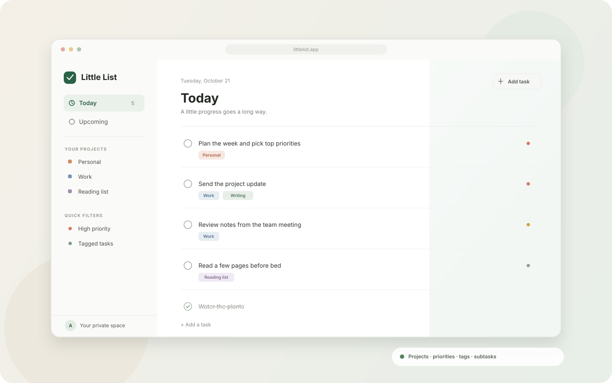
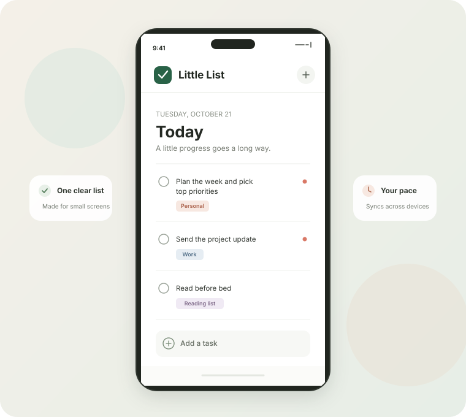

# Little List

A small, responsive to-do app with email/password accounts. Each account has a private list that syncs across devices. Its focused, sidebar-based workspace keeps project and tag administration out of the way while you work. The frontend is built with React and Vite; Supabase provides authentication and storage.

**Sign out** ends the session on the current device. Other devices remain signed in.

## A little preview

A calm workspace on desktop, with the same focused task list on mobile.

<p align="center">
  
</p>
<p align="center">
  
</p>

## Run locally

1. Install Node.js 20.19+ or 22.12+.
2. Copy `.env.example` to `.env`.
3. Create a Supabase project and set `VITE_SUPABASE_URL` and `VITE_SUPABASE_PUBLISHABLE_KEY` in `.env`. The publishable key is intended for browser use; never put a secret or service-role key in this app.
4. In the Supabase dashboard, open **SQL Editor** and run the contents of [`supabase/schema.sql`](./supabase/schema.sql). This creates the task, project, and tag tables with row-level security policies that keep each user's data private.

5. Install dependencies and start the dev server:

   ```sh
   npm install
   npm run dev
   ```

Run the automated unit tests with `npm test`.

New users may need to confirm their email before signing in. Before inviting friends, configure a custom SMTP provider under **Authentication → Emails** so confirmation messages can be delivered reliably. For a temporary friends-only demo, you can instead disable email confirmation under **Authentication → Sign In / Providers**; this allows unverified email addresses to sign in.

If the project was created using an earlier version of the setup SQL, run [`supabase/restrict_todo_grants.sql`](./supabase/restrict_todo_grants.sql) in the SQL Editor to remove excess default table permissions and grant only the operations the app needs.

Existing installations should apply new files in [`supabase/migrations/`](./supabase/migrations/) through the Supabase SQL Editor before deploying frontend changes that depend on them. The soft-delete migration adds `deleted_at` without changing existing tasks; the priority migration adds a constrained priority column and gives existing tasks `none`; the projects migration adds owner-scoped projects and an optional project association for tasks; the tags migration adds reusable owner-scoped tags and a task-tag association with ownership-safe foreign keys; the subtasks migration adds a same-owner parent-task relationship limited to one nesting level.

## Host it online with Vercel

1. Push this project to a GitHub repository.
2. Import the repository in [Vercel](https://vercel.com/new). Vercel should detect Vite automatically.
3. In the Vercel project settings, add `VITE_SUPABASE_URL` and `VITE_SUPABASE_PUBLISHABLE_KEY` under **Environment Variables**, then deploy.
4. In Supabase, open **Authentication → URL Configuration**. Set **Site URL** to your Vercel URL and add that URL (and your local URL, `http://localhost:5173`) to **Redirect URLs**.
5. Share the live [Little List app](https://littlelist-app.vercel.app) with your friends. They can create their own accounts; row-level security keeps their lists private from one another.

After changing environment variables, redeploy the Vercel project so the values are included in the frontend build.

### Deploy without Git

If this folder is not connected to a Git repository, you can build locally and deploy only the static output directory with the Vercel CLI:

```sh
npm install
npm exec --yes --package=vercel -- vercel login
npm run build
npm exec --yes --package=vercel -- vercel link --cwd .\\dist --project little-list --scope anaiks-projects --yes
npm exec --yes --package=vercel -- vercel deploy dist --prod
```

The local build reads `.env.local`; the command uploads the generated `dist` site, not `.env.local`. Link the rebuilt `dist` folder before each deployment because Vite recreates that folder during the build. The Supabase publishable key is intended for browser use. Do not use a Supabase secret or service-role key in this frontend.

The current production URL is <https://littlelist-app.vercel.app>. New accounts may need to confirm their email; configure a custom SMTP provider in Supabase before relying on email delivery for a wider audience.

## Current development status

- **Phase 1 — Foundation:** React/Vite, Supabase email/password auth, per-user row-level security, responsive base layout, and hosting are in place. User profile management is not implemented.
- **Phase 2 — Core tasks:** Create, list, complete/reopen, inline title editing, soft delete, trash/restore, and undo are implemented. Hard deletion is only offered from Trash with confirmation. The production database has the soft-delete migration applied.
- **Phase 3 — Organization:** Structured priorities and project creation, filtering, rename, reorder, archive/unarchive, and delete are deployed. Project deletion keeps tasks and moves them to No project. Reusable private tags, task assignment, and tag filtering are deployed. One-level subtasks with completion progress and inherited project/tags are deployed; the production database has the subtask migration applied. Task ordering remains future work.
- **Phases 4–7:** Due dates, reminders, recurring tasks, search, advanced views, offline support, export, and collaboration remain future work.
- **Phase 8 — Production hardening:** The app is deployed and has basic loading/error handling. Automated testing is being added incrementally; broader security, accessibility, observability, and performance audits remain.
