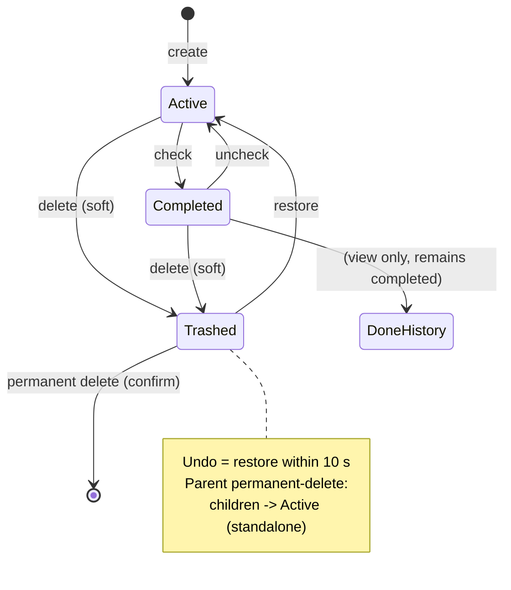
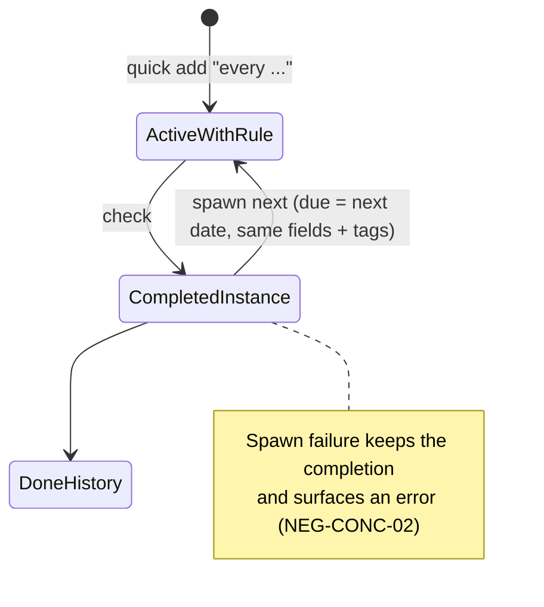
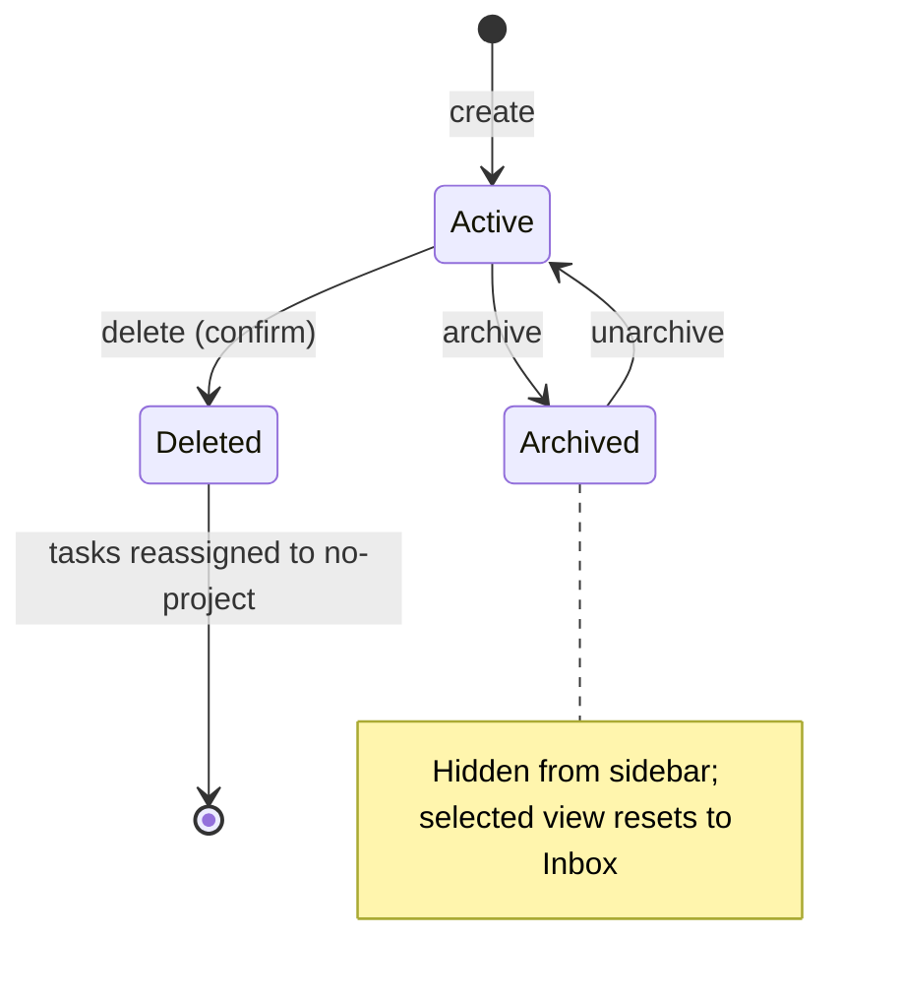

# State-Transition Test Cases

Lifecycle model for tasks, projects, and recurring tasks. Every arrow below has a case; impossible transitions have negative cases.

## Task state model

## Transition cases

| ID | Requirement | Preconditions | Test data | Steps | Expected result | Pri | Risk | Auto |
|---|---|---|---|---|---|---|---|---|
| ST-01 Active→Completed | R-TASK-04 | Active task | — | Check | Struck-through; Done count +1; stays in Inbox list | P0 | H | High |
| ST-02 Completed→Active | R-TASK-04 | Completed task | — | Uncheck | Strike removed; Active count +1 | P0 | H | High |
| ST-03 Active→Trashed | R-TASK-05 | Active task | — | Delete | Leaves view; Trash count +1; Undo notice 10 s | P0 | H | High |
| ST-04 Completed→Trashed | R-TASK-05 | Completed task | — | Delete from Done view | Same as ST-03 (completed tasks can be trashed) | P1 | M | Med |
| ST-05 Trashed→Active (restore) | R-TASK-06 | Trashed task | — | Restore in Trash | Returns as active (uncompleted state preserved as-was) | P0 | H | Med |
| ST-06 Trashed→Active (undo) | R-TASK-05 | Just-deleted task | — | Click Undo within 10 s | Same as ST-05 without visiting Trash | P0 | H | Med |
| ST-07 Trashed→gone (permanent) | R-TASK-07 | Trashed task | — | × + confirm | Removed permanently; counts drop; never reappears | P0 | H | Med |
| ST-08 Trashed parent permanent-delete → children promoted | R-SUB-04 | Trashed parent + trashed child | — | Permanent-delete parent only | Child returns to Inbox as a standalone active task (parent_task_id set null) | P0 | H | Med |
| ST-09 Subtask completed ≠ parent completed | R-SUB-03 | Parent + subtask | — | Complete subtask only | Parent remains Active with progress 1/1 — never auto-completes | P0 | H | High |
| ST-10 Completed subtask visible under active parent | R-SUB-03 | Active parent, done subtask | — | Open Active view | Parent listed with struck-through subtask nested; progress line shown | P1 | M | High |
| ST-11 Trashed pair renders nested, no progress line | R-SUB-03, R-TASK-06 | Trashed parent + trashed child | — | Open Trash | Both visible (child nested under parent); no "x / y completed" line in Trash | P1 | M | Med |

## Recurring-task state machine (extends the task model)

| ID | Requirement | Preconditions | Test data | Steps | Expected result | Pri | Risk | Auto |
|---|---|---|---|---|---|---|---|---|
| ST-12 complete→spawn | R-REC-02 | Recurring task due D | — | Check | Completed copy in Done + new ActiveWithRule due nextRecurrenceDate(D) | P0 | H | High |
| ST-13 reopen a recurring (not completed) instance | R-REC-02 | ActiveWithRule | — | Uncheck | Returns to Active; **no** extra spawn on reopen path (spawn only on completion) | P1 | M | Med |
| ST-14 trash a recurring task | R-REC-01, R-TASK-05 | ActiveWithRule | — | Delete (no completion) | Goes to Trash; no next occurrence spawned — spawn is completion-triggered only | P1 | M | Med |
| ST-15 complete recurring with no due date | R-REC-02 | ActiveWithRule, due_date null | — | Check | Next occurrence due nextRecurrenceDate(today) (documented fallback) | P1 | M | High |

## Project state machine

| ID | Requirement | Preconditions | Test data | Steps | Expected result | Pri | Risk | Auto |
|---|---|---|---|---|---|---|---|---|
| ST-16 Active↔Archived round-trip | R-PROJ-04 | Project with position P | — | Archive → reload → unarchive | Sidebar hidden then restored at position P; selected-view reset verified | P1 | M | Med |
| ST-17 Active→Deleted keeps tasks | R-PROJ-05 | Project owns task T | — | Delete + confirm | T active with no project (Inbox); project gone | P0 | H | Med |
| ST-18 Archived project's tasks still exist | R-PROJ-04 | Archived project owns T | — | Search T | Findable in search/Inbox-level views while project archived | P2 | L | Med |
| ST-19 deleted project's filter self-cleanup | R-PROJ-05 | Project selected as filter | — | Delete it | View falls back; no dangling filter on missing id | P1 | M | Med |

## Modal state machine

| ID | Requirement | Preconditions | Steps | Expected result | Pri | Risk | Auto |
|---|---|---|---|---|---|---|---|
| ST-20 closed→open→submitted | R-MOD-01 | Any view | Open → valid input → submit | Modal closes; task created | P0 | H | Med |
| ST-21 open→cancelled (3 paths) | R-MOD-01 | Open modal | Escape / backdrop / Cancel | Closed; draft cleared; nothing created | P1 | M | Med |
| ST-22 open→failed submit | R-MOD-01, R-TASK-02 | Offline | Submit valid task | Modal stays open; error shown; draft preserved | P1 | M | Med |
